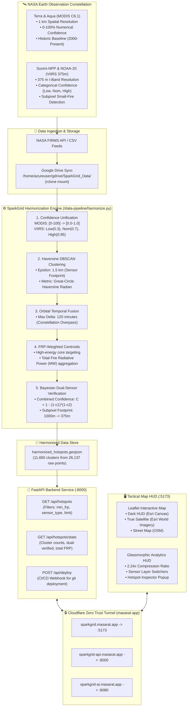

# 🛰️ SparkGrid — System Architecture & Technical Specifications
> **NASA Space Apps Cairo 2026** • Challenge: *Harmonization of MODIS and VIIRS Hot Spots*

---

## 1. High-Level Architecture Overview



---

## 2. Infrastructure & Cloud Deployment Topology

```mermaid
flowchart LR
    subgraph Users["👥 End Users & Judges"]
        Browser["Web Browser / Mobile / GIS"]
    end

    subgraph CloudflareEdge["☁️ Cloudflare Global Edge (SSL Termination)"]
        Edge["Universal SSL Certificate (*.masarat.app)\nDDoS Protection & CDN Caching"]
    end

    subgraph AzureVNet["🌐 Azure Virtual Network (10.0.0.0/16 - UAE North)"]
        subgraph JarvisCloud["Jarvis-Cloud VM (10.0.0.4)"]
            Tunnel["cloudflared daemon\n(Encrypted Outbound Tunnel)"]
            Hermes["Hermes AI Agent\n(Discord & Telegram Standup Bot)"]
        end

        subgraph RemoteDesktopVM["RemoteDesktop-VM (10.0.1.4) - Main Compute"]
            Vite["React 18 + Vite HUD\n(Port 5173)"]
            FastAPI["FastAPI 0.115 Service\n(Port 8000)"]
            DockerAI["Open WebUI Docker\n(Port 8080)"]
            Cron["Auto-Deploy Cron\n(Every 2 min git pull & build)"]
            RClone["rclone mount\nGoogle Drive SparkGrid_Data/"]
        end
    end

    Browser <-->|HTTPS :443| Edge
    Edge <-->|Cloudflare Tunnel (QUIC)| Tunnel
    Tunnel <-->|Internal VNet 10.0.1.4:5173| Vite
    Tunnel <-->|Internal VNet 10.0.1.4:8000| FastAPI
    Tunnel <-->|Internal VNet 10.0.1.4:8080| DockerAI
    Cron -.->|git reset & restart| FastAPI
    Cron -.->|npm run build| Vite
```

---

## 3. Mathematical & Algorithmic Formulation

### A. Confidence Unification Function
$$c_{\text{MODIS}} = \frac{\text{confidence}}{100}$$
$$c_{\text{VIIRS}} = \begin{cases} 0.30 & \text{if } \text{confidence} = \text{'low'} \\ 0.70 & \text{if } \text{confidence} = \text{'nominal'} \\ 0.95 & \text{if } \text{confidence} = \text{'high'} \end{cases}$$

### B. Haversine Radian Distance Metric
For two coordinate tuples $(\phi_1, \lambda_1)$ and $(\phi_2, \lambda_2)$ in radians:
$$d = 2 R \arcsin \left( \sqrt{\sin^2\left(\frac{\Delta \phi}{2}\right) + \cos(\phi_1)\cos(\phi_2)\sin^2\left(\frac{\Delta \lambda}{2}\right)} \right)$$
where $R = 6371.0088\text{ km}$, $\epsilon = \frac{1.5\text{ km}}{R}$ radians.

### C. Fire Radiative Power (FRP) Weighted Centroid
Rather than calculating an unweighted geometric mean that can misplace the fire front, SparkGrid weights spatial coordinates by instantaneous thermal radiance:
$$\bar{\phi} = \frac{\sum_{i=1}^N \phi_i \cdot \text{FRP}_i}{\sum_{i=1}^N \text{FRP}_i}, \quad \bar{\lambda} = \frac{\sum_{i=1}^N \lambda_i \cdot \text{FRP}_i}{\sum_{i=1}^N \text{FRP}_i}$$

### D. Multi-Sensor Bayesian Verification
When a cluster contains observations from both MODIS ($S_M$) and VIIRS ($S_V$) within the orbital delta window $|\Delta t| \le 120\text{ min}$:
$$C_{\text{fused}} = 1 - \prod_{i=1}^N (1 - c_i)$$
The cluster is flagged as `is_multi_sensor = true`, and its effective ground resolution is refined from the coarse $1000\text{m}$ grid to the fine-grained $375\text{m}$ subpixel resolution.