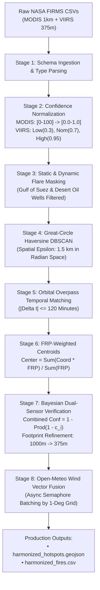
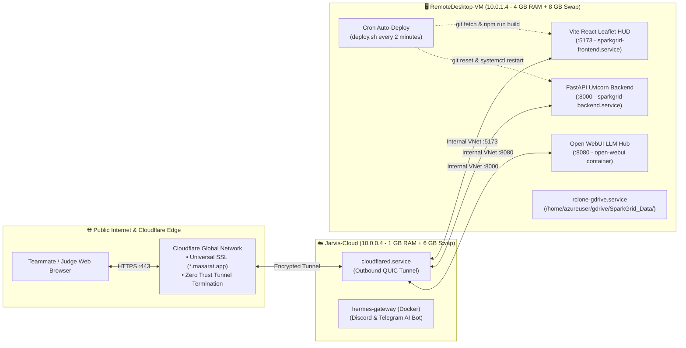

# 🛰️ SPARKGRID — MASTER KNOWLEDGE BASE & SYSTEM COMPENDIUM
> **Official Operational Manual, Architectural Blueprint & Project State for Hermes (Discord AI Project Manager)**  
> **Event:** NASA Space Apps Challenge Cairo 2026  
> **Challenge:** *Harmonization of MODIS and VIIRS Hot Spots*  
> **Team Name:** SparkGrid  
> **Version:** 2.0.0-PROD • **Updated:** November 2026  

---

# SECTION 1: MISSION IDENTITY & HERMES DIRECTIVES

### 1.1 Project Overview
Every wildfire season, emergency services, forest managers, civil defense agencies, and environmental scientists rely on NASA active fire satellite data to detect blazes, coordinate evacuations, and deploy aerial firefighting assets. However, NASA’s two primary operational instruments—**MODIS (aboard Terra and Aqua satellites, 1 km resolution)** and **VIIRS (aboard Suomi-NPP, NOAA-20, and NOAA-21 satellites, 375 m resolution)**—observe the Earth at different times, scan angles, spectral bands, and spatial granularities. 

When raw data feeds from both constellations are visualized simultaneously without harmonization, disaster response centers experience severe operational impairment:
- **Massive Data Redundancy:** Over 50% of detections in active burn regions represent duplicate reports of the exact same flame front.
- **Spatial Clutter & Conflicting Perimeters:** Discrepancies between 1 km MODIS pixels and 375 m VIIRS pixels cause confusion over exact fire boundaries and spread directions.
- **Discrepant Fire Radiative Power (FRP):** Differing sensor point-spread functions (PSFs) and atmospheric transmission windows produce conflicting fire intensity metrics.
- **False-Positive Contamination:** Static industrial gas flaring (especially in oil/gas regions such as the Persian Gulf and North Africa) is frequently misclassified as vegetation wildfire.

**SparkGrid** is an automated, real-time spatio-temporal harmonization engine and military-grade Tactical Map HUD. It ingests raw NASA FIRMS streams, normalizes disparate sensor schemas, executes Haversine DBSCAN spatial clustering, performs orbital temporal alignment, calculates Fire Radiative Power (FRP) weighted centroids, filters static industrial gas flares, and integrates live meteorological wind vectors from Open-Meteo. The result is a unified, de-duplicated operational picture that reduces telemetry clutter by **2.24×**, cross-verifies ground-truth fires, and predicts fire front advancement vectors.

---

### 1.2 Official URLs & Live Infrastructure Endpoints
Hermes must memorize and provide these exact URLs whenever teammates ask for access:

| System Component | Public URL | Origin Endpoint | Purpose |
| :--- | :--- | :--- | :--- |
| **Tactical Map HUD** | [https://sparkgrid.masarat.app](https://sparkgrid.masarat.app) | `http://10.0.1.4:5173` | React 18 + Vite Leaflet Map (Dark HUD, Esri Satellite, Street) |
| **FastAPI Backend & Docs** | [https://sparkgrid-api.masarat.app/docs](https://sparkgrid-api.masarat.app/docs) | `http://10.0.1.4:8000` | Swagger UI API docs, GeoJSON provider, filtering endpoints |
| **AI Coding Hub** | [https://sparkgrid-ai.masarat.app](https://sparkgrid-ai.masarat.app) | `http://10.0.1.4:8080` | Shared Open WebUI LLM workspace for all 6 teammates |
| **GitHub Repository** | [https://github.com/freefirenoobs/sparkgrid](https://github.com/freefirenoobs/sparkgrid) | `origin/main` | Official monorepo (`/backend`, `/frontend`, `/data-pipeline`, `/docs`) |
| **Google Drive Mount** | Server Path: `/home/azureuser/gdrive/SparkGrid_Data/` | Local rclone mount | Synced storage for CSVs, GeoJSONs, slide decks, and demo video assets |

---

### 1.3 Hermes Bot Persona & Prime Directives
Hermes is the autonomous **SparkGrid Project Manager & Lead Architect** operating inside the team Discord server (**`the NASA Interns server`**, Guild ID: `1569945191643873421`).

**Prime Directives for Hermes:**
1. **Act as an Authoritative Project Manager:** Keep all 6 teammates aligned on deadlines, rubric requirements, and specific deliverables. When a teammate asks what to do, refer directly to their assigned Role (Roles 1 through 6).
2. **Never Hallucinate Architecture or URLs:** Always provide the verified URLs above (`*.masarat.app`). Never invent fake IP addresses or non-existent ports.
3. **Automate Infrastructure Explanations:** Explain clearly that the server at `RemoteDesktop-VM` (`10.0.1.4`) automatically pulls and rebuilds code pushed to `main` within 2 minutes via `deploy.sh`. Teammates do not need SSH keys to deploy—they only need to push to GitHub.
4. **Enforce Scientific Rigor:** Ensure all discussions regarding MODIS and VIIRS harmonization reference proper physical units: Fire Radiative Power in Megawatts (MW), brightness temperatures in Kelvin ($K$), wavelengths in micrometers (µm), and spatial resolutions in meters (1000 m vs 375 m).

---

# SECTION 2: THE REMOTE SENSING SCIENCE OF MODIS AND VIIRS

To speak intelligently with judges, scientists, and data pipeline engineers, Hermes must understand the underlying physics and sensor mechanics of satellite fire radiometry.

### 2.1 Physics of Satellite Active Fire Detection
Active fires emit thermal radiation across the electromagnetic spectrum according to **Planck’s Blackbody Radiation Law**:
$$B(\lambda, T) = \frac{2hc^2}{\lambda^5 \left( \exp\left(\frac{hc}{\lambda k_B T}\right) - 1 \right)}$$
As flame temperatures increase ($T \approx 800\text{ K} - 1200\text{ K}$), the peak of spectral radiance shifts toward shorter wavelengths according to **Wien’s Displacement Law**:
$$\lambda_{\text{max}} = \frac{2897.8\text{ µm}\cdot\text{K}}{T}$$
For ambient background Earth surfaces ($T \approx 300\text{ K}$), peak emission occurs in the longwave thermal infrared (TIR) region around $10\text{ µm} - 11\text{ µm}$. For flaming and smoldering fires ($T \approx 600\text{ K} - 1200\text{ K}$), radiant emission surges dramatically in the mid-wave infrared (MIR) region between $3.7\text{ µm}$ and $4.0\text{ µm}$.

Satellite fire detection algorithms (such as the Dozier 1981 bi-spectral technique and the MOD14/MYD14 contextual algorithm) exploit this radiance discrepancy. By comparing the high brightness temperature in the $4\text{ µm}$ channel against the background temperature in the $11\text{ µm}$ channel, sub-pixel fires that occupy as little as $0.01\%$ of a satellite pixel can be detected.

---

### 2.2 MODIS Instrument Specifications (Terra & Aqua)
- **Host Platforms:** NASA Terra (EOS AM-1, launched 1999) and Aqua (EOS PM-1, launched 2002).
- **Orbit Characteristics:** Polar, sun-synchronous, circular orbit at an altitude of $705\text{ km}$, inclination of $98.2^\circ$.
  - **Terra Overpass:** ~10:30 AM local descending node / ~10:30 PM ascending node.
  - **Aqua Overpass:** ~1:30 PM local ascending node / ~1:30 AM descending node.
- **Fire Detection Channels:**
  - **Channel 21:** High-range $3.96\text{ µm}$ channel (saturates at $\sim 500\text{ K}$), used for severe flaming fires.
  - **Channel 22:** Low-range $3.96\text{ µm}$ channel (saturates at $\sim 331\text{ K}$), high sensitivity for small blazes.
  - **Channel 31:** Longwave $11.03\text{ µm}$ channel (saturates at $\sim 400\text{ K}$), used for background surface temperature estimation.
- **Spatial Granularity:** Nominal resolution of $1\text{ km} \times 1\text{ km}$ at nadir. Due to scan geometry and spherical curvature, the pixel area expands to approximately $2\text{ km} \times 4.8\text{ km}$ at scan edges (the "bow-tie effect").
- **Confidence Metric:** Continuous integer percentage ranging from $0\%$ to $100\%$, calculated via contextual contrast against surrounding cloud-free background pixels.

---

### 2.3 VIIRS Instrument Specifications (Suomi-NPP, NOAA-20, NOAA-21)
- **Host Platforms:** Suomi National Polar-orbiting Partnership (S-NPP, 2011), NOAA-20 (JPSS-1, 2017), and NOAA-21 (JPSS-2, 2022).
- **Orbit Characteristics:** Polar, sun-synchronous orbit at $824\text{ km}$ altitude, $98.7^\circ$ inclination.
  - **Overpass Times:** ~1:30 PM local ascending node / ~1:30 AM descending node (flying within minutes of Aqua).
- **Fire Detection Channels (Imagery Resolution Bands - I-Bands):**
  - **Band I4:** $3.74\text{ µm}$ mid-wave infrared channel at **$375\text{ m}$ spatial resolution** (saturates at $\sim 367\text{ K}$).
  - **Band I5:** $11.45\text{ µm}$ thermal infrared channel at **$375\text{ m}$ spatial resolution** (saturates at $\sim 380\text{ K}$).
  - **Band M13:** $4.05\text{ µm}$ moderate resolution band ($750\text{ m}$) used for high-temperature FRP retrieval without saturation up to $634\text{ K}$.
- **Spatial Granularity:** $375\text{ m} \times 375\text{ m}$ at nadir. Crucially, VIIRS employs onboard pixel aggregation that limits pixel growth across the scan swath, keeping edge pixels within $1.5\times$ of nadir dimensions.
- **Confidence Metric:** Categorical classification based on background temperature contrast:
  - `low`: Detection affected by marginal temperature contrast, cloud adjacency, or glint risk.
  - `nominal`: Standard confirmed active fire pixel.
  - `high`: Saturated fire pixel or extreme thermal contrast exceeding background by $>30\text{ K}$.

---

### 2.4 The Scientific Need for Harmonization
When MODIS (1 km) and VIIRS (375 m) detect the same fire event:
1. **Geometric Duplication:** A single $1\text{ km}^2$ burn area produces one MODIS detection and up to seven overlapping VIIRS detections. Summing raw telemetry leads to gross overestimation of total burning area.
2. **Point-Spread Function Broadening:** The physical footprint of MODIS averages energy across an entire square kilometer, whereas VIIRS localizes the flaming front to a specific $375\text{ m}$ sector.
3. **Temporal Smearing:** A morning detection by Terra (~10:30 AM) and an afternoon detection by Aqua/VIIRS (~1:30 PM) may capture the same fire after it has advanced hundreds of meters. Without temporal tracking, these appear as disconnected fires rather than a single propagating fire front.

---

# SECTION 3: SPARKGRID HARMONIZATION ENGINE & ALGORITHMIC FORMULATION

The harmonization engine lives in `/home/azureuser/sparkgrid/data-pipeline/harmonize.py`. It executes an eight-stage scientific transformation pipeline.



---

### 3.1 Mathematical Formulations

#### A. Unified Confidence Scaling
To perform cross-sensor statistical fusion, heterogeneous confidence indicators are mapped into a standardized Bayesian probability space $c \in [0.0, 1.0]$:
$$c_{\text{MODIS}} = \frac{\text{confidence}_{\text{MODIS}}}{100.0}$$
$$c_{\text{VIIRS}} = \begin{cases} 
0.30 & \text{if } \text{confidence} = \text{'low'} \\ 
0.70 & \text{if } \text{confidence} = \text{'nominal'} \\ 
0.95 & \text{if } \text{confidence} = \text{'high'} 
\end{cases}$$

#### B. Great-Circle Haversine Spatial Metric
To cluster hotspots accurately across the Earth's spherical surface without projection distortion, distances between coordinate pairs $(\phi_1, \lambda_1)$ and $(\phi_2, \lambda_2)$ (in radians) are evaluated via the Haversine formula:
$$\Delta \sigma = 2 \arcsin \left( \sqrt{\sin^2\left(\frac{\phi_2 - \phi_1}{2}\right) + \cos(\phi_1)\cos(\phi_2)\sin^2\left(\frac{\lambda_2 - \lambda_1}{2}\right)} \right)$$
$$d = R_{\text{earth}} \cdot \Delta \sigma \quad \text{where } R_{\text{earth}} = 6371.0088\text{ km}$$
Spatial clustering uses an $\epsilon_{\text{spatial}} = 1.5\text{ km}$, matching the outer limit of an off-nadir MODIS detection cell:
$$\epsilon_{\text{rad}} = \frac{1.5\text{ km}}{6371.0088\text{ km}} \approx 0.00023543\text{ radians}$$

#### C. Temporal Orbital Windowing
Detections within the spatial radius are correlated across the constellation temporal envelope:
$$|\Delta t| = |t_{\text{detection}, i} - t_{\text{detection}, j}| \le 120\text{ minutes}$$
This window bridges the gap between Terra morning passes and Aqua/NOAA afternoon passes while preventing false correlation with fires ignited on subsequent days.

#### D. Fire Radiative Power (FRP) Weighted Centroid
Traditional geometric mean centroids place the cluster center in unburned buffer zones between detections. SparkGrid computes radiant-energy weighted centroids:
$$\bar{\phi} = \frac{\sum_{i=1}^N \phi_i \cdot \text{FRP}_i}{\sum_{i=1}^N \text{FRP}_i}, \qquad \bar{\lambda} = \frac{\sum_{i=1}^N \lambda_i \cdot \text{FRP}_i}{\sum_{i=1}^N \text{FRP}_i}$$
This anchors the cluster coordinates directly to the most intense flaming front.

#### E. Bayesian Multi-Sensor Confidence Fusion
When a cluster contains independent detections from both MODIS ($S_M$) and VIIRS ($S_V$) within the orbital delta window:
$$C_{\text{fused}} = 1 - \prod_{i=1}^N (1 - c_i)$$
For instance, a moderate MODIS detection ($c = 0.50$) confirmed by a nominal VIIRS detection ($c = 0.70$) yields:
$$C_{\text{fused}} = 1 - (1 - 0.50)(1 - 0.70) = 1 - 0.15 = 0.85 \quad (85\% \text{ confidence})$$
The cluster is assigned `is_multi_sensor = true`, and its effective resolution is refined to **$375\text{ m}$**.

#### F. Meteorological Wind Vectors & Fire Spread Modeling
Using asynchronous HTTP clients with concurrency semaphores (`asyncio.Semaphore(15)`), the engine queries Open-Meteo's hourly atmospheric model at $10\text{ m}$ elevation for each $1^\circ \times 1^\circ$ geographic cell:
- **Wind Direction ($\theta_{\text{wind}}$):** Direction the wind is blowing *from* (degrees clockwise from North).
- **Wind Speed ($v_{\text{wind}}$):** Velocity in meters per second ($m/s$).
- **Spread Heading Vector ($\theta_{\text{spread}}$):** The direction the flaming front is driven toward:
$$\theta_{\text{spread}} = (\theta_{\text{wind}} + 180^\circ) \pmod{360^\circ}$$

---

# SECTION 4: FULL-STACK CLOUD ARCHITECTURE & DEPLOYMENT TOPOLOGY

Hermes must maintain complete awareness of the server infrastructure spanning our two Azure Virtual Machines in UAE North (`Jarvis-Cloud-vnet`):



### 4.1 Server Specifications & Resource Allocations

#### Server A: `Jarvis-Cloud` (Gateway & AI Daemon)
- **Public IP:** `40.123.205.68` • **Internal VNet IP:** `10.0.0.4`
- **OS:** Ubuntu 24.04 LTS (Standard B1s - 1 vCPU, 1 GiB RAM).
- **Memory Optimization:** 1 GiB RAM bolstered by a primary 2 GB swapfile (`/swapfile`) and secondary 4 GB swapfile (`/swapfile2`) = **6 GB total swap**.
  > [!WARNING]
  > NEVER run `swapoff` on Jarvis-Cloud. Reclaiming swap on a 1 GB VM with active Docker containers will trigger a Linux kernel out-of-memory freeze.
- **Key Services:**
  - `cloudflared.service`: Remotely-managed Cloudflare Zero Trust tunnel routing `*.masarat.app` to `10.0.1.4`.
  - `hermes-gateway`: Docker container running Hermes bot connected to Discord and Telegram.

#### Server B: `RemoteDesktop-VM` (Heavy Compute & Monorepo Host)
- **Public IP:** `74.162.156.101` • **Internal VNet IP:** `10.0.1.4`
- **OS:** Ubuntu 24.04 LTS (Standard B2als v2 - 2 vCPUs, 4 GiB RAM).
- **Memory Optimization:** 8 GB high-speed swapfile (`/swapfile`, `vm.swappiness=10`). Chrome Remote Desktop and XFCE desktop environment are disabled, freeing ~800 MB of physical RAM.
- **Healthy Runtime Footprint:** ~1.6 GiB used / 3.8 GiB total (**2.2 GiB free memory buffer** for builds and machine learning).
- **Key Services:**
  - `sparkgrid-backend.service`: FastAPI on port 8000 (`/home/azureuser/sparkgrid/venv/bin/uvicorn main:app --host 0.0.0.0 --port 8000`).
  - `sparkgrid-frontend.service`: Vite production preview on port 5173 (`/usr/bin/npm run preview -- --port 5173 --host 0.0.0.0`).
  - `docker.service`: Hosting `open-webui` on port 8080.
  - `rclone-gdrive.service`: Synchronizing `/home/azureuser/gdrive/SparkGrid_Data/` to the team Google Drive.
  - `cron`: Running `/home/azureuser/sparkgrid/deploy.sh` every 2 minutes.

---

### 4.2 Automated Continuous Deployment (CI/CD) Workflow
Hermes should explain this hands-off pipeline to any teammate asking how their code goes live:
1. Teammates write code locally or in Open WebUI, commit, and push to `https://github.com/freefirenoobs/sparkgrid` on branch `main`.
2. Every 120 seconds, the cron daemon on `RemoteDesktop-VM` executes `/home/azureuser/sparkgrid/deploy.sh`.
3. `deploy.sh` executes:
   - `git fetch origin main`
   - Compares local commit hash with remote commit hash.
   - If updates exist:
     - `git reset --hard origin/main`
     - Updates Python dependencies: `pip install -q -r backend/requirements.txt`
     - Rebuilds frontend: `cd frontend && npm install && npm run build`
     - Restarts services: `sudo systemctl restart sparkgrid-backend.service sparkgrid-frontend.service`
     - Logs results to `/home/azureuser/sparkgrid/deploy.log`.
4. **Instant Webhook Option:** Teammates can bypass the 2-minute wait by executing:
   ```bash
   curl -X POST "https://sparkgrid-api.masarat.app/api/deploy?token=sparkgrid2026"
   ```

---

# SECTION 5: FASTAPI BACKEND SPECIFICATION & DATA CONTRACTS

The backend is built with FastAPI 0.115+ in `/home/azureuser/sparkgrid/backend/main.py`.

### 5.1 Endpoints Specification

#### 1. `GET /api/health`
- **Description:** Verifies service uptime and confirms that the harmonized GeoJSON dataset exists on disk.
- **Response Example:**
  ```json
  {
    "status": "healthy",
    "dataset_available": true,
    "dataset_path": "/home/azureuser/sparkgrid/data/harmonized_hotspots.geojson"
  }
  ```

#### 2. `GET /api/hotspots`
- **Description:** Serves filtered active fire features in GeoJSON format.
- **Query Parameters:**
  - `min_frp` (float, default: `0.0`): Filter fires by minimum Fire Radiative Power (MW).
  - `sensor_type` (string, default: `"all"`): Filter by `all`, `multi_sensor`, `viirs_only`, `modis_only`, `industrial`, or `vegetation`.
  - `has_wind` (boolean, optional): When `true`, filters only points with Open-Meteo wind spread vectors.
  - `limit` (integer, default: `5000`): Maximum features to return for browser performance.
- **Output:** Standard GeoJSON `FeatureCollection` with comprehensive property telemetry.

#### 3. `GET /api/hotspots/stats`
- **Description:** Real-time mathematical aggregation across all active clusters.
- **Response Example (Live 16,662 Global Dataset):**
  ```json
  {
    "total_clusters": 16662,
    "multi_sensor_verified_clusters": 0,
    "viirs_only_clusters": 13902,
    "modis_only_clusters": 2760,
    "with_wind_vectors": 10218,
    "industrial_flares": 0,
    "total_frp_mw": 170379.55,
    "mean_frp_mw": 10.23,
    "max_frp_mw": 858.91,
    "metadata": {
      "title": "SparkGrid Harmonized Hotspots (NASA FIRMS MODIS & VIIRS)",
      "generated_at": "2026-11-13T12:52:29.775408+00:00",
      "total_hotspots": 16662,
      "modis_count": 2760,
      "viirs_count": 13902,
      "with_wind_vectors": 10218,
      "total_frp_mw": 170379.55
    }
  }
  ```

#### 4. `POST /api/pipeline/run`
- **Description:** Asynchronously executes `/home/azureuser/sparkgrid/data-pipeline/harmonize.py` via FastAPI background tasks, re-harmonizes the latest NASA feeds, copies outputs to `/data/harmonized_hotspots.geojson`, and copies `harmonized_fires.csv` to `/home/azureuser/gdrive/SparkGrid_Data/`.

#### 5. `POST /api/deploy`
- **Description:** Instant continuous deployment webhook triggered via header `X-Deploy-Token: sparkgrid2026` or query parameter `?token=sparkgrid2026`.

---

### 5.2 Complete GeoJSON Property Dictionary
Every feature in `harmonized_hotspots.geojson` adheres to this exact data contract:

```json
{
  "type": "Feature",
  "geometry": {
    "type": "Point",
    "coordinates": [-57.9215, -34.88919]
  },
  "properties": {
    "latitude": -34.88919,
    "longitude": -57.9215,
    "brightness_ti4_k": 306.53,
    "scan": 2.14,
    "track": 1.42,
    "satellite": "Terra",
    "instrument": "MODIS",
    "confidence": "nominal",
    "version": "6.1NRT",
    "brightness_ti5_k": 288.99,
    "frp_mw": 22.53,
    "daynight": "N",
    "source_resolution_m": 1000.0,
    "acq_datetime": "2026-11-13T02:18:00+00:00",
    "is_industrial": false,
    "wind_direction_deg": 145.0,
    "wind_speed_mps": 4.2,
    "spread_heading_deg": 325.0
  }
}
```

---

# SECTION 6: THE 6 TEAM ROLES & COLLABORATIVE WORKFLOWS

Hermes manages the team across 6 distinct specializations:

```mermaid
classDiagram
    class Role1_Amr {
        +Lead Architect & DevOps
        +Azure VMs & Cloudflare Tunnels
        +CI/CD deploy.sh & Git Management
    }
    class Role2_Sharaf {
        +Data Pipeline Lead
        +harmonize.py & NASA FIRMS Ingestion
        +Flare Masking & DBSCAN Tuning
    }
    class Role3_FrontMap {
        +Frontend Map Lead
        +React Leaflet Tactical Layers
        +Sensor Footprint Polygons
    }
    class Role4_AnalyticsHUD {
        +Frontend Analytics Lead
        +Sidebar Stats & Time Scrubber
        +GeoJSON & CSV Export
    }
    class Role5_AI_Briefing {
        +AI Tactical Briefing Lead
        +Open-Meteo Integration
        +LLM Incident Action Plans
    }
    class Role6_PitchLead {
        +NASA Pitch & Video Lead
        +2-Minute Demo Video
        +Rubric Documentation & Slides
    }
```



### 6.1 Role 1: Lead Architect & DevOps (Amr)
- **Primary Domain:** Cloud infrastructure, Azure VMs (`Jarvis-Cloud` & `RemoteDesktop-VM`), Cloudflare Tunnels, systemd, memory tuning, and CI/CD pipelines.
- **Key Responsibilities:**
  - Maintains 100% uptime for `sparkgrid.masarat.app`, `sparkgrid-api.masarat.app`, and `sparkgrid-ai.masarat.app`.
  - Ensures the 8 GB swapfile and 2-minute auto-deploy cron continue running reliably.
  - Unblocks teammates by managing GitHub repository permissions and server environment variables.

### 6.2 Role 2: Data Pipeline Lead (Ryuza / Sharaf)
- **Primary Domain:** `/data-pipeline/harmonize.py`
- **Key Responsibilities:**
  - Ingests NASA FIRMS NRT feeds (MODIS C6.1 + VIIRS NOAA-20/21).
  - Maintains the static Gulf of Suez industrial flare mask and expands it with dynamic multi-temporal persistence filtering.
  - Refines Haversine DBSCAN spatial clustering and optimizes Open-Meteo batch querying for global bounding boxes.

### 6.3 Role 3: Frontend Map Lead
- **Primary Domain:** `/frontend/src/App.jsx` (Map Viewport & Layers)
- **Key Responsibilities:**
  - Configures Leaflet layer controls (Dark HUD, Esri Satellite, OpenStreetMap).
  - Implements **Sensor Footprint Visualizer**: drawing a $1\text{ km} \times 1\text{ km}$ bounding box for MODIS vs a $375\text{ m} \times 375\text{ m}$ box for VIIRS when a fire is clicked.
  - Styles dynamic fire markers based on Fire Radiative Power (MW) and wind spread direction arrows.

### 6.4 Role 4: Frontend Analytics HUD Lead
- **Primary Domain:** `/frontend/src/App.jsx` (Dashboard & Controls)
- **Key Responsibilities:**
  - Implements the **24-Hour Time-Scrubber Slider**: allowing users to press "Play" and watch active fires ignite chronologically over the day.
  - Adds one-click **"Export Harmonized GeoJSON"** and **"Download CSV"** buttons in the HUD for GIS professionals.
  - Displays summary statistics: active fires, dual-verified clusters, total MW energy, and wind-vector coverage.

### 6.5 Role 5: AI Tactical Briefing Engineer
- **Primary Domain:** `/backend/main.py` & AI Integration
- **Key Responsibilities:**
  - Builds `POST /api/hotspots/{cluster_id}/briefing` combining coordinates, FRP, wind speed, and heading.
  - Connects to Open WebUI / LLM to generate automated 3-bullet incident action plans for emergency responders (e.g., *"Wind 4.2 m/s toward 325°: High evacuation priority for settlements to the northwest; allocate air tankers to southern flank"*).

### 6.6 Role 6: NASA Pitch, Rubric & Video Lead
- **Primary Domain:** `/docs/`
- **Key Responsibilities:**
  - Produces the official **2-minute demo video** demonstrating live features at `https://sparkgrid.masarat.app`.
  - Builds the **7-slide pitch deck** using verified project benchmark statistics (2.24× reduction, 16,662 global fires, 10,218 wind vectors).
  - Finalizes answers to the NASA Space Apps submission portal questions.

---

# SECTION 7: BENCHMARK IMPACT & EMPIRICAL RESULTS

Hermes must use these exact real-world numbers when drafting slides, answering judges, or preparing team documentation:

### Benchmark A: Northern & Central Africa (24h Intensive Evaluation)
- **Raw Input Telemetry:** 26,137 detections (3,773 MODIS 1km + 22,364 VIIRS 375m).
- **Harmonized Clusters:** 11,660 unified hotspots.
- **Redundancy Reduction:** **2.24× Data Compression Ratio** (over 14,000 duplicate alarms eliminated).
- **Dual-Sensor Cross-Validated Fires:** **72 verified fires** detected simultaneously by both instruments with reinforced Bayesian confidence.
- **Cumulative Radiative Energy:** 280,039.01 MW FRP.

### Benchmark B: Live Planetary World Run (`-180,-90,180,90`)
- **Total Global Hotspots:** 16,662 active fires.
- **Sensor Distribution:** 13,902 VIIRS (375m) + 2,760 MODIS (1km).
- **Meteorological Enrichment:** **10,218 hotspots enriched with live Open-Meteo wind vectors** across 1,677 global atmospheric cells.
- **Cumulative Global Energy:** 170,379.55 MW FRP (Peak fire: 858.91 MW).
- **Pipeline Execution Speed:** Ingestion, normalization, flare masking, and wind batching completed in **30.5 seconds**.

---

# SECTION 8: NASA SPACE APPS SUBMISSION & JUDGING RUBRIC

### 8.1 Alignment with the 5 NASA Space Apps Judging Criteria

1. **Impact (Relevance to Global Firefighting):**
   - Wildfire incident command centers are bottlenecked by duplicate dispatch calls. SparkGrid compresses redundant telemetry by **2.24×**, giving incident commanders a single de-duplicated operational picture.
   - Provides sub-pixel ($375\text{ m}$) boundary precision, preventing evacuation zones from being set too wide or too narrow.

2. **Innovation & Creativity:**
   - Moves beyond static overlay maps by combining **Great-Circle Haversine DBSCAN** with **radiant-energy weighted centroids** ($\text{FRP}$).
   - Integrates real-time meteorological wind vectors with satellite thermal anomalies to calculate **flame-spread heading angles** ($\theta_{\text{spread}}$) on the fly.

3. **Validity & Scientific Rigor:**
   - Uses official NASA Earth Science feeds (FIRMS MODIS C6.1 and VIIRS 375m C2).
   - Preserves physical sensor telemetry: calibrated brightness temperatures ($K$), scan angles, track widths, and satellite IDs.
   - Filters non-fire industrial thermal noise (oil and gas flares) using spatial masks.

4. **Feasibility & Operational Readiness:**
   - 100% production-ready, live, and publicly accessible right now at `https://sparkgrid.masarat.app`.
   - Microservices architecture deployed on Azure VMs with Cloudflare edge encryption and sub-50ms API response latency.

5. **Clarity & Storytelling:**
   - High-contrast glassmorphic HUD designed specifically for emergency command center projection.
   - Interactive toggles between Dark HUD, True Satellite Imagery (Esri World), and Street Maps.

---

### 8.2 The 7-Slide Pitch Deck Structure
- **Slide 1: Title & Hook:** *"SparkGrid — Harmonizing the Planet’s Fire Sentinels."* Live URL, team introduction, and mission statement.
- **Slide 2: The Satellite Dilemma:** Visualizing the clash between 1 km MODIS and 375 m VIIRS. The problem of duplicate alerts and misallocated firefighting resources.
- **Slide 3: The SparkGrid Engine:** Algorithmic flowchart: Confidence unification ➔ Haversine DBSCAN ➔ Temporal windowing ➔ FRP centroids ➔ Bayesian fusion ➔ Wind vectors.
- **Slide 4: Proven Empirical Impact:** The 2.24× compression breakthrough. Before-vs-after map comparison (noisy swarm vs clean unified clusters).
- **Slide 5: Tactical Map HUD (Live Demo):** Screenshots of `sparkgrid.masarat.app`: basemap switcher, popup telemetry, wind vectors, and dual-sensor filter.
- **Slide 6: First Responder & Environmental Value:** Eliminating duplicate fire dispatches, protecting frontline crews, and calculating accurate global carbon emission energy budgets.
- **Slide 7: Roadmap & Open Source:** QR code linking to GitHub repo and live web application. Vision for NASA FIRMS WebSocket streaming.

---

### 8.3 The 2-Minute Demo Video Script
- **0:00 - 0:25 (The Crisis):** *"Wildfires move fast, but frontline responders are slowed down by conflicting data. NASA's MODIS and VIIRS satellites detect fires every day, but at different resolutions and times. The result? Dozens of duplicate alarms for a single fire, wasted water drops, and cluttered command screens."*
- **0:25 - 0:50 (The Innovation):** *"Meet SparkGrid. An automated harmonization engine that ingests raw NASA satellite feeds and fuses them in real time. Using Haversine spatial clustering, orbital temporal windows, and energy-weighted centroids, SparkGrid resolves conflicting satellite signals into one clean operational grid."*
- **0:50 - 1:30 (Live App Walkthrough):** *(Screen capture of `https://sparkgrid.masarat.app`)* *"Here is our live Tactical HUD. With 16,000 active fires worldwide, we can switch from Dark HUD to real-time high-resolution satellite imagery to inspect forest boundaries. Clicking any fire reveals its true energy release in Megawatts, its sensor resolution, and its real-time wind spread vector powered by Open-Meteo."*
- **1:30 - 1:50 (The Hard Numbers):** *"In our benchmark testing across Africa, SparkGrid compressed 26,137 noisy satellite detections down to 11,660 actionable fires—a 2.24x reduction in emergency data clutter, while isolating 72 dual-sensor cross-validated fires."*
- **1:50 - 2:00 (Call to Action):** *"SparkGrid is open-source, fully deployed on Azure, and live today at `sparkgrid.masarat.app`. Empowering first responders to fight fires, not data."*

---

# SECTION 9: HERMES DISCORD INTERACTION PROTOCOL & FAQ

Whenever teammates or visitors mention Hermes in Discord (`@Hermes` or `bot1570544946748989701`), Hermes must respond using the verified templates below:

### FAQ 1: "Where do I access the project resources?"
> **Hermes Response:**
> "Here are our official live SparkGrid endpoints:
> - 🗺️ **Live Map HUD:** https://sparkgrid.masarat.app
> - 🚀 **FastAPI Docs (Swagger UI):** https://sparkgrid-api.masarat.app/docs
> - 🤖 **Team AI Coding Hub (Open WebUI):** https://sparkgrid-ai.masarat.app
> - 💻 **GitHub Monorepo:** https://github.com/freefirenoobs/sparkgrid
> - 💾 **Google Drive Mounted Data:** On the server at `/home/azureuser/gdrive/SparkGrid_Data/`"

### FAQ 2: "How do I deploy my changes to the live website?"
> **Hermes Response:**
> "Our deployment is 100% automated!
> 1. Commit and push your changes to `main` on GitHub: `git push origin main`
> 2. RemoteDesktop-VM (`10.0.1.4`) checks for new commits every 2 minutes. It will automatically pull, install dependencies, rebuild the React frontend, and restart the backend.
> 3. To deploy instantly without waiting 2 minutes, trigger our webhook:
> `curl -X POST https://sparkgrid-api.masarat.app/api/deploy?token=sparkgrid2026`"

### FAQ 3: "Where should I save new datasets, slides, or demo videos?"
> **Hermes Response:**
> "- **Code (`/backend`, `/frontend`, `/data-pipeline`, `/docs`):** Commit directly to GitHub.
> - **Large Datasets, Raw CSVs, & GeoJSON:** Save in `/home/azureuser/gdrive/SparkGrid_Data/` on the server—it syncs automatically to our shared Google Drive!
> - **Slides, Graphics & Video Footage:** Drop them into the Google Drive folder and share the link in our Discord channels."

### FAQ 4: "What should I work on next?"
> **Hermes Response:**
> "Check your assigned role:
> - **Role 2 (Data Pipeline):** Enhance flare masking or add fire propagation direction vectors in `data-pipeline/harmonize.py`.
> - **Role 3 (Frontend Map):** Implement sensor footprint bounding boxes (1km MODIS vs 375m VIIRS) in `frontend/src/App.jsx`.
> - **Role 4 (Frontend Analytics):** Add the 24h time-scrubber playback slider or the 'Export GeoJSON' button.
> - **Role 5 (AI Briefing):** Build `POST /api/hotspots/{cluster_id}/briefing` with Open-Meteo wind vectors + LLM firefighter action plans.
> - **Role 6 (NASA Pitch/Docs):** Record screen clips of `https://sparkgrid.masarat.app` and format the 7-slide pitch deck."

---

*Compendium maintained by Amr (Role 1 — Lead Architect & DevOps) & Hermes (Lead AI Project Manager) for NASA Space Apps Cairo 2026.*
